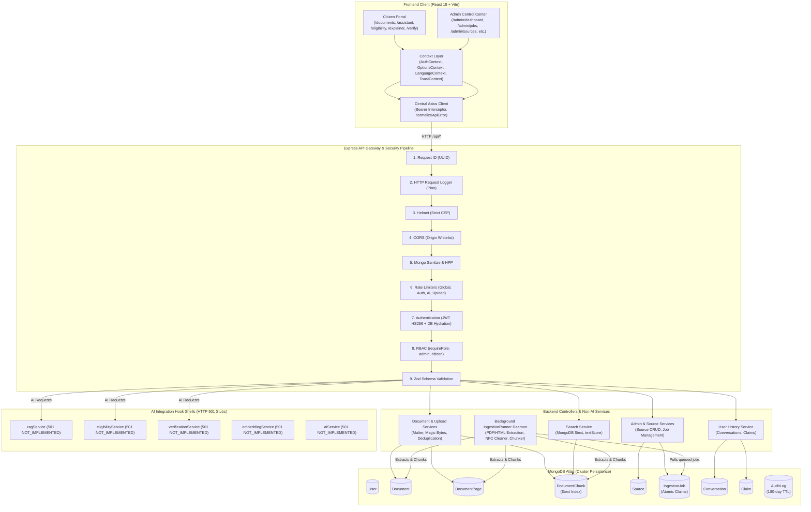
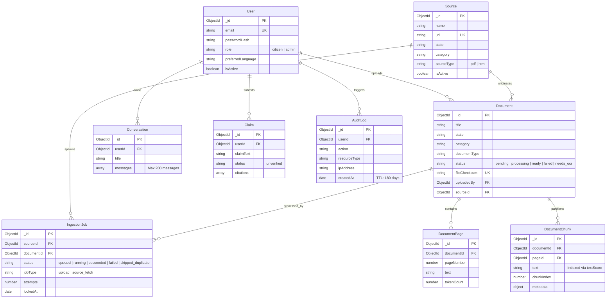
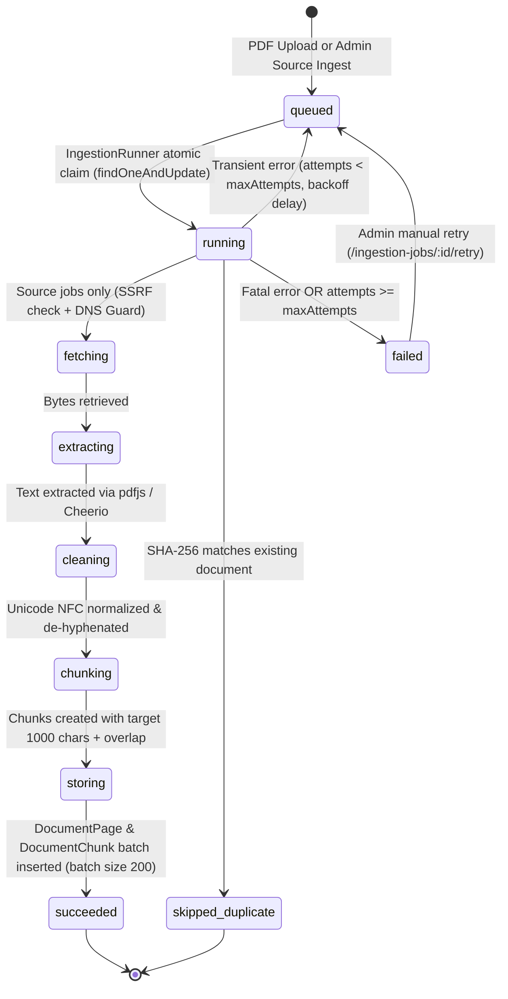

# JanSathi AI — System Architecture (`ARCHITECTURE.md`)

> **Project**: JanSathi AI (जन साथी AI)  
> **Theme**: FORGE '26 — Theme 1: Civic Pulse  
> **Architecture Style**: Decoupled MERN Monorepo with Strict Non-AI Foundation Governance  
> **Verification**: Inspected and verified directly against repository codebase.

---

## 1. High-Level Architecture Overview

JanSathi AI connects Indian citizens to official government gazettes, schemes, and verification pipelines. The platform is architecturally partitioned into a mobile-first, responsive React 18 client and a hardened Node.js/Express 4 backend with MongoDB Atlas persistence.

---

## 2. Frontend Architecture (React 18 + Vite)

### 2.1 Workspace Structure (`client/`)

- **Build Tool**: Vite 5 with `@vitejs/plugin-react` and Tailwind CSS 3.4.
- **Client Entry**: [`client/src/main.jsx`](file:///c:/Users/SUBHASH/OneDrive/Desktop/Janshanti/client/src/main.jsx) renders `<App />` wrapped in `<BrowserRouter>`, `<ToastProvider>`, `<AuthProvider>`, `<LanguageProvider>`, and `<OptionsProvider>`.
- **Routing**: React Router 6 in [`client/src/App.jsx`](file:///c:/Users/SUBHASH/OneDrive/Desktop/Janshanti/client/src/App.jsx).

### 2.2 Context Layer

1. **`AuthContext`**: Manages user authentication state, token storage via `tokenStorage.js`, login, registration, and logout. Decoupled from Axios via `setUnauthorizedHandler`.
2. **`LanguageContext`**: Provides instant UI translation across English (`en`), Hindi (`hi`), Telugu (`te`), and Tamil (`ta`).
3. **`OptionsContext`**: Fetches and caches system configuration metadata from `/api/meta/options` (states, categories, document types, income brackets, upload limits).
4. **`ToastContext`**: Accessible alert toast notifications with keyboard dismissal.

### 2.3 Route Guarding

- **`ProtectedRoute`**: Inspects `isAuthenticated`; redirects unauthenticated citizens to `/login?redirect=...`.
- **`AdminRoute`**: Inspects `isAuthenticated` and verifies `user.role === 'admin'`. Non-admins are redirected with security toast warnings.
- **`AdminLayout`**: Dedicated administrative shell featuring desktop fixed sidebar (`lg:pl-64`), mobile overlay drawer (`AdminSidebar`), administrative topbar (`AdminHeader`), `<Outlet />`, and return switcher to the citizen portal.

### 2.4 Error Handling & HTTP Client

- **`client/src/services/api.js`**: Central Axios instance configured with `timeout: 20000` and `baseURL: import.meta.env.VITE_API_BASE_URL || '/api'`.
- **Request Interceptor**: Injects `Authorization: Bearer <token>` on every outgoing request.
- **Response Interceptor**: Intercepts HTTP 401 on non-login endpoints, clears local credentials, and dispatches the global unauthorized handler.
- **`normalizeApiError(err)`**: Normalizes Axios exceptions, network drops, rate limits (extracting `Retry-After`), and HTTP 501 `NOT_IMPLEMENTED` envelopes into a predictable UI model.

---

## 3. Backend Architecture (Node.js + Express 4)

### 3.1 Request Lifecycle & Middleware Pipeline

Every incoming HTTP request flows sequentially through the following pipeline defined in [`server/src/app.js`](file:///c:/Users/SUBHASH/OneDrive/Desktop/Janshanti/server/src/app.js):

1. **`requestId`**: Generates or forwards a unique `X-Request-Id` for end-to-end tracing.
2. **`httpLogger`**: Structured Pino HTTP logging with sensitive token/password redaction and query string stripping.
3. **`helmetMiddleware`**: Sets strict JSON API Content-Security-Policy and Cross-Origin Resource Policy.
4. **`corsMiddleware`**: Enforces strict origin matching against `CLIENT_ORIGIN` for browser requests.
5. **`express.json`**: Parses JSON payloads up to `BODY_LIMIT` (default 100kb). URL-encoded parsing is disabled.
6. **`sanitizeMiddleware`**: Strips forbidden MongoDB query characters (`$` and `.`).
7. **`hppMiddleware`**: Prevents HTTP Parameter Pollution.
8. **`globalLimiter`**: 300 requests / 15 minutes window; skips `/api/health*` telemetry probes.
9. **Route Controllers**: Express router hierarchy dispatching to controllers.
10. **`notFound`**: Catches unmapped routes, returning HTTP 404 `NOT_FOUND`.
11. **`errorHandler`**: Centralized error boundary masking internal errors, transforming Mongoose errors, and logging errors with full request context.

---

## 4. Database Models & Relationships

JanSathi AI utilizes 9 Mongoose schemas in MongoDB Atlas:

---

## 5. Ingestion Pipeline & Background Worker

### 5.1 Ingestion State Machine

The background worker (`jobs/ingestionRunner.js`) operates without external queue services (no Redis), coordinating tasks atomically through MongoDB:

### 5.2 Key Ingestion Pipeline Components:

- **`services/pdfService.js`**: `pdfjs-dist` text extraction with line break reconstruction and `MAX_PDF_PAGES=300` limit.
- **`services/htmlService.js`**: Cheerio HTML parser segmenting content into pages via `h1`-`h3` section headers.
- **`services/textCleaner.js`**: Preserves Indic scripts (Telugu, Devanagari, Tamil) with Unicode NFC normalization, strips unprintable control codes, and removes repeated headers/footers.
- **`services/chunkingService.js`**: Sentence-aware deterministic chunking with configurable overlap (`CHUNK_TARGET_CHARS=1000`, `CHUNK_MAX_CHARS=1500`, `CHUNK_OVERLAP_CHARS=150`).
- **`services/fetchService.js`**: SSRF defense with socket-level DNS verification, max 3 manual redirects, and domain pinning.

---

## 6. AI Integration Architecture (Future "AI-Day" Handover)

JanSathi AI was designed with stable hook shells so that AI capabilities can be plugged in without changing database schemas, client-facing routes, or security middleware.

| Hook Component                        | Current Phase 13 Status                                                                       | Future "AI-Day" Replacement                                                                                                                                 |
| :------------------------------------ | :-------------------------------------------------------------------------------------------- | :---------------------------------------------------------------------------------------------------------------------------------------------------------- |
| **`services/retrievalService.js`**    | Functional: MongoDB `$text` search over `DocumentChunk` with `score: { $meta: 'textScore' }`. | Hybrid Search: Combines `$vectorSearch` with `$text` using Reciprocal Rank Fusion (RRF). Interface `retrieve({ query, filters, limit })` remains identical. |
| **`services/embeddingService.js`**    | Shell: Throws `NotImplementedError`.                                                          | Embeddings: Generates dense vectors (e.g. 768-dim) for background chunks during ingestion and user queries during retrieval.                                |
| **`services/aiService.js`**           | Shell: Throws `NotImplementedError`.                                                          | LLM Runtime: Calls LLM with forced JSON schema validation and few-shot civic system prompts.                                                                |
| **`services/ragService.js`**          | Shell: Throws `NotImplementedError`.                                                          | Grounding & Synthesis: Synthesizes retrieved gazette chunks, verifies source URLs, and appends messages to `Conversation`.                                  |
| **`services/eligibilityService.js`**  | Shell: Throws `NotImplementedError`.                                                          | Criteria Evaluator: Matches applicant demographic attributes against structured criteria extracted from schemes.                                            |
| **`services/verificationService.js`** | Shell: Throws `NotImplementedError`.                                                          | Stance Classifier: Classifies citizen rumors against official circulars (`supported`, `contradicted`, `unverified`) and logs to `Claim`.                    |
