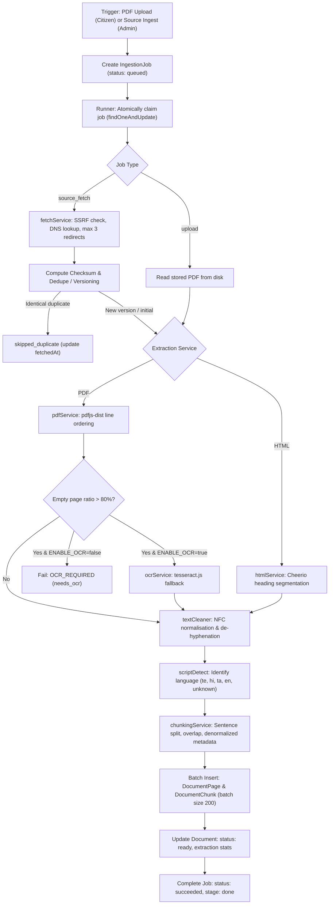
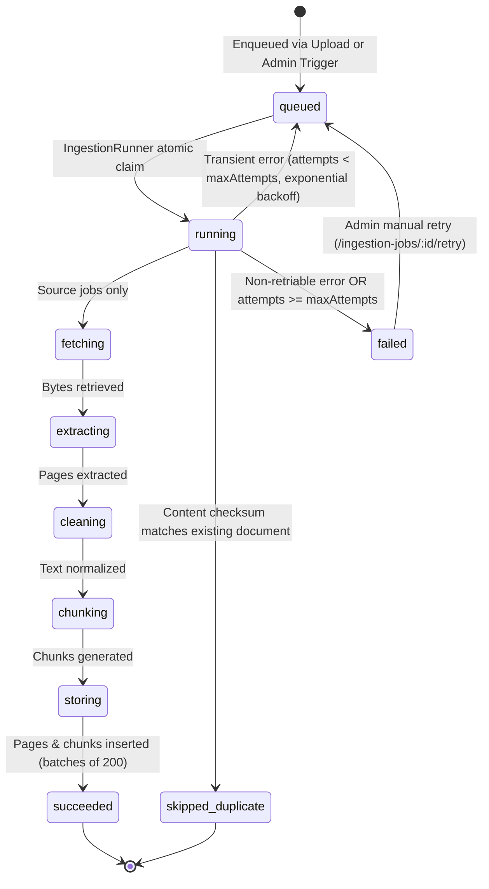

# JanSathi AI Architecture

JanSathi AI is built as a modular MERN-stack monorepo designed to empower Indian citizens with accurate, transparent access to government schemes, notifications, and eligibility criteria. The architecture separates concerns between a mobile-first, responsive React 18 client and a robust Node.js/Express 4 backend with MongoDB Atlas persistence. Non-AI workflows (authentication, scheme discovery, document ingestion, and administrative oversight) form the bedrock of the platform, with well-defined hook points prepared for AI, translation, RAG, and vector search capabilities in subsequent phases.

---

## 1. Document Ingestion Pipeline Architecture

The ingestion pipeline (`services/ingestionService.js`, `jobs/ingestionRunner.js`) operates asynchronously without external dependencies (no Redis), coordinating work through atomic MongoDB status claims.

---

## 2. Ingestion Job State Machine

---

## 3. Error Classification & Retry Policy

| Error Code / Scenario                                      | Retriable? | Policy & Backoff Behavior                                                                  | Target Document Status           |
| :--------------------------------------------------------- | :--------- | :----------------------------------------------------------------------------------------- | :------------------------------- |
| **Network timeout / DNS drop** (`ETIMEDOUT`, `ECONNRESET`) | **Yes**    | Exponential backoff ($5000 \times 2^{\text{attempt}-1} + \text{jitter}$), up to 3 attempts | Remains `processing` until retry |
| **HTTP 429 / 5xx**                                         | **Yes**    | Requeued with backoff delay                                                                | Remains `processing` until retry |
| **Database transient**                                     | **Yes**    | Requeued with backoff delay                                                                | Remains `processing` until retry |
| **SSRF Blocked** (`SSRF_BLOCKED`)                          | **No**     | Immediate failure, logged to security audit                                                | `failed`                         |
| **HTTP 404 / 410 / 403**                                   | **No**     | Immediate failure                                                                          | `failed`                         |
| **Corrupt PDF** (`PDF_CORRUPT`)                            | **No**     | Immediate failure                                                                          | `failed`                         |
| **Encrypted PDF** (`PDF_ENCRYPTED`)                        | **No**     | Immediate failure                                                                          | `failed`                         |
| **Exceeded Pages** (`PDF_TOO_MANY_PAGES`)                  | **No**     | Immediate failure                                                                          | `failed`                         |
| **Scanned Image** (`OCR_REQUIRED`)                         | **No**     | Immediate failure                                                                          | `needs_ocr`                      |
| **Unsupported Content** (`UNSUPPORTED_CONTENT`)            | **No**     | Immediate failure                                                                          | `failed`                         |
| **Max Retries Exceeded**                                   | **No**     | Marked `failed` with code `MAX_RETRIES_EXCEEDED`                                           | `failed`                         |
